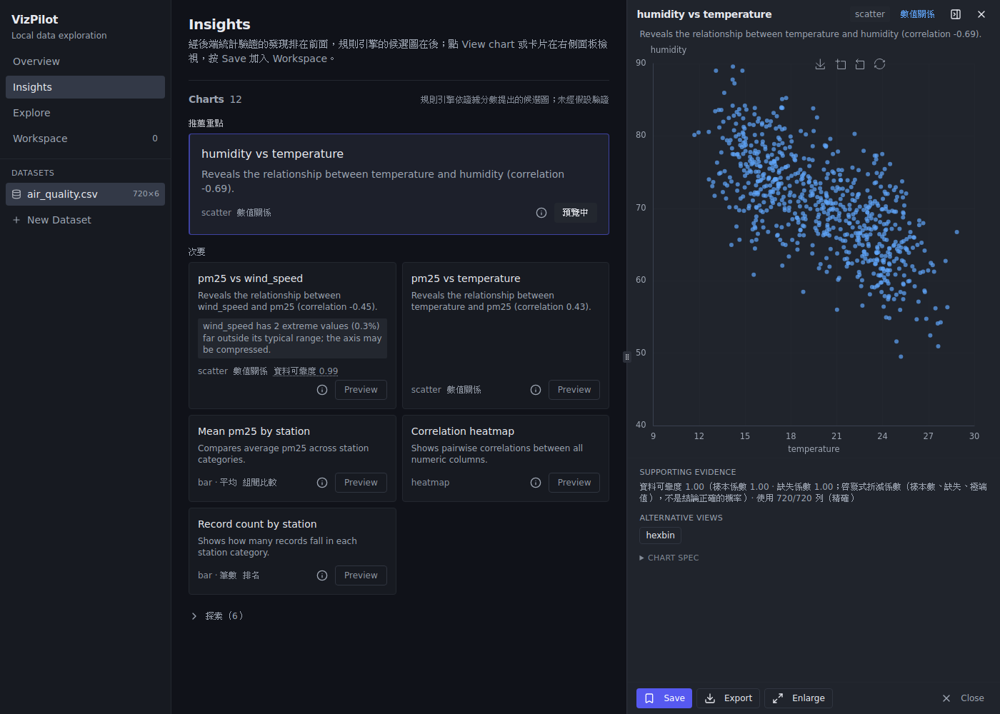
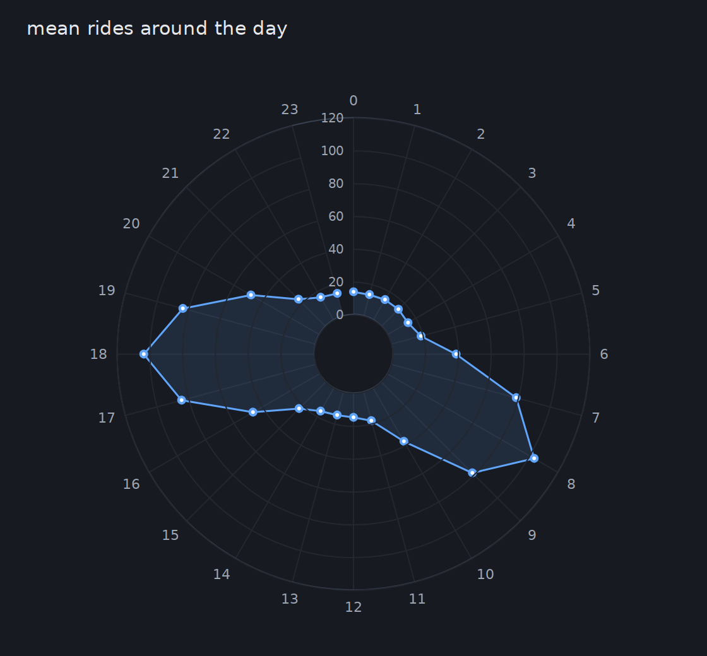
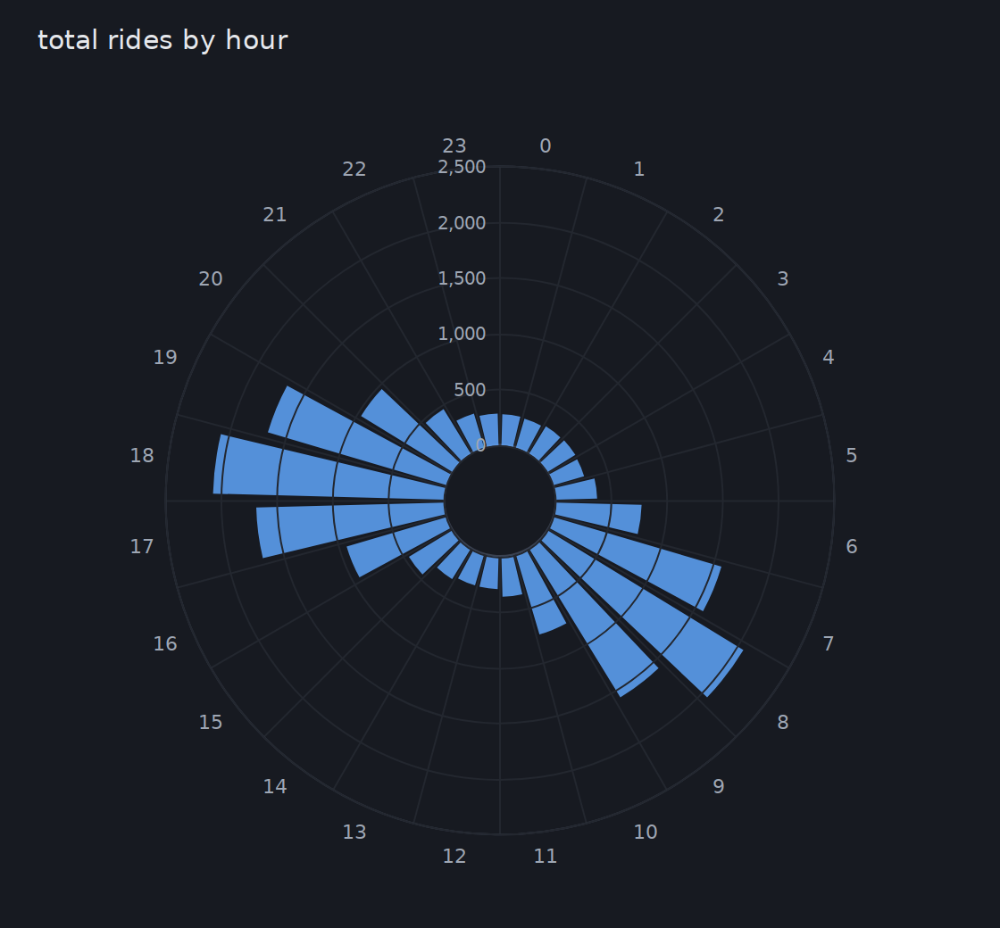
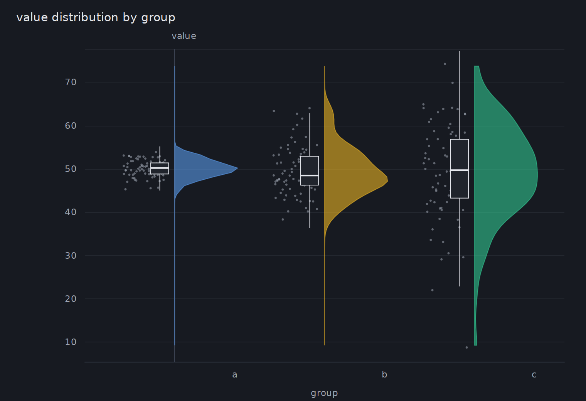
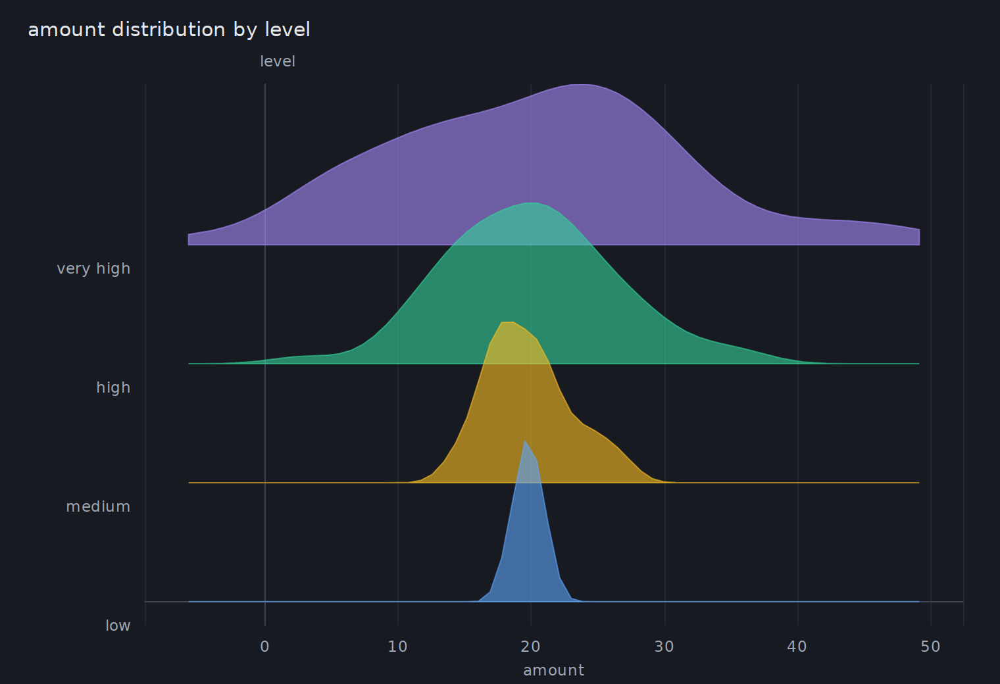
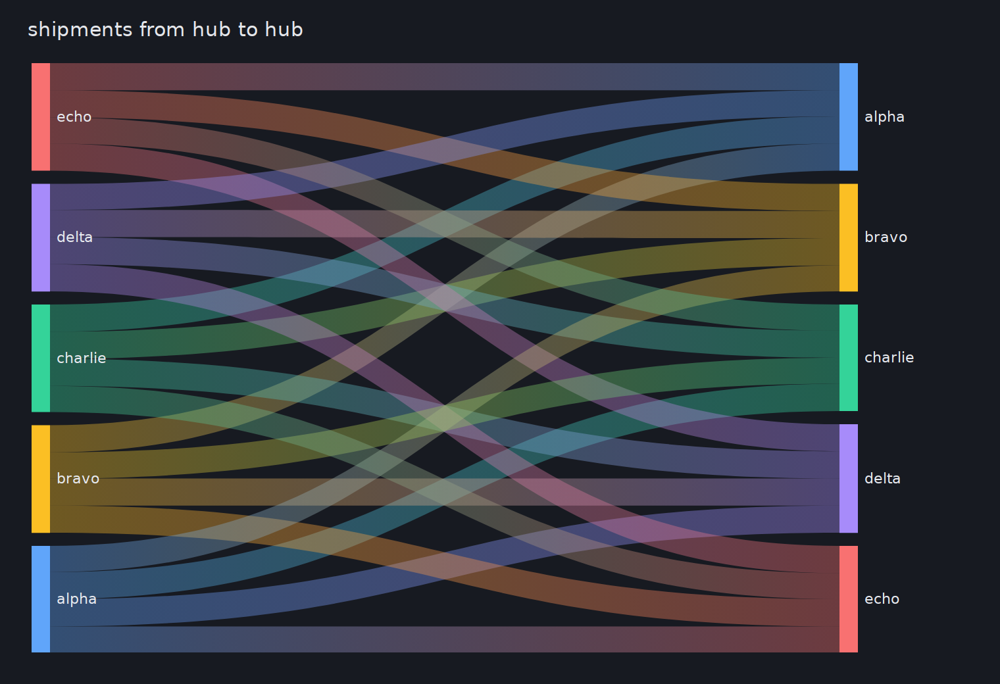
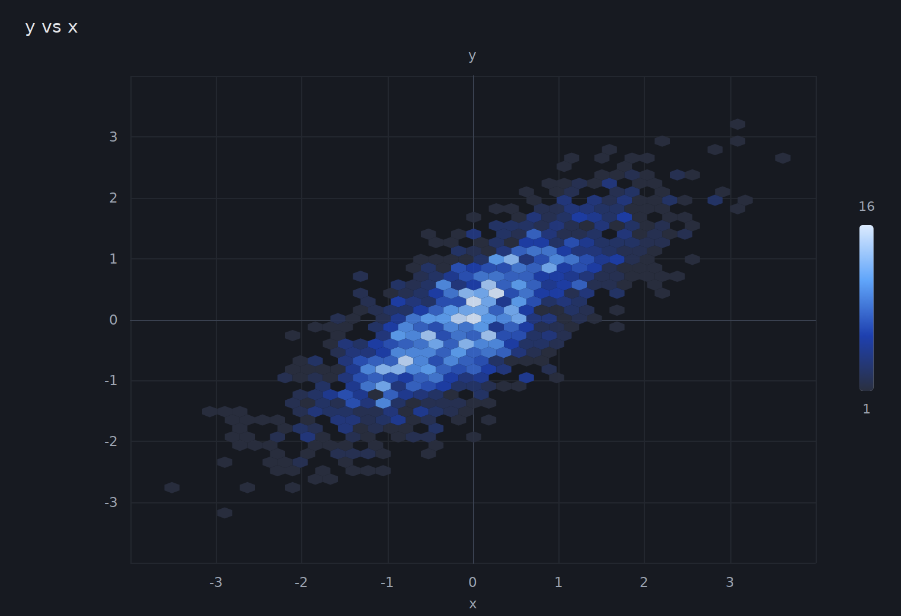
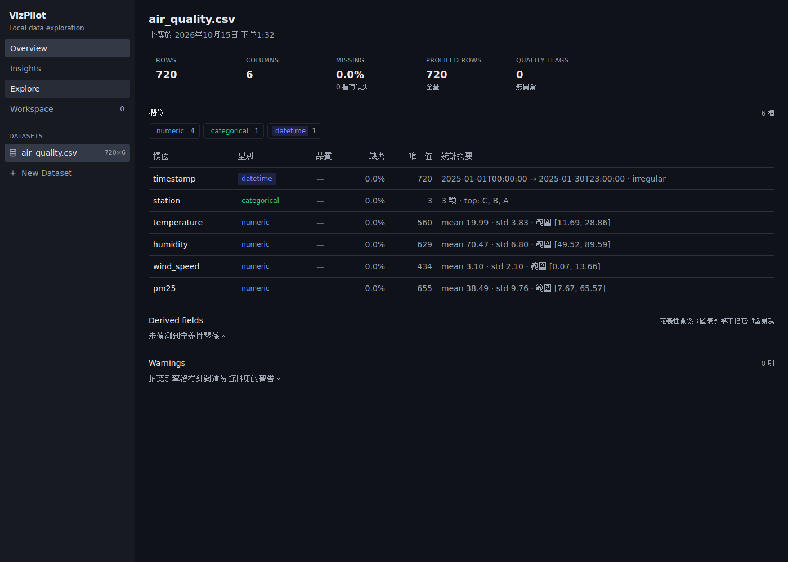
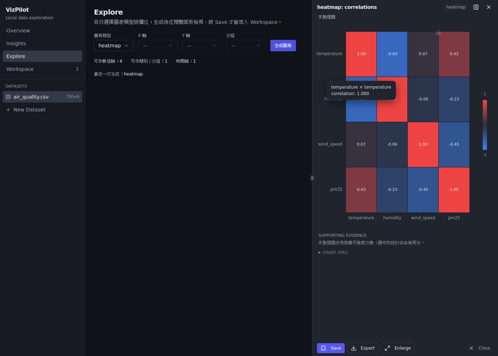
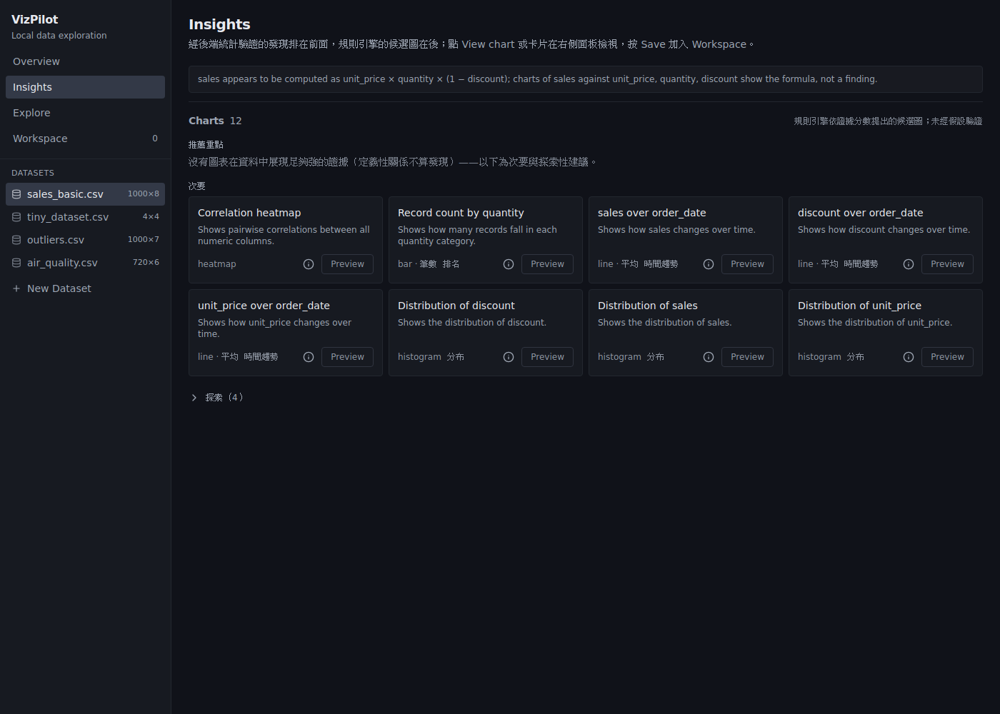

# VizPilot

**An evidence-gated AI pipeline for exploratory data analysis.** Upload a
tabular dataset and get an automatic profile, chart recommendations and
written findings — where a local language model may *propose* hypotheses, but
every reported claim must be backed by a statistic the backend computed and
tested. Runs fully locally; raw data never leaves your machine, and the app
works completely without the LLM.



> Upload data → profile → evidence (effect sizes + tests) → rules / LLM hypotheses → evidence gate → validated charts and findings.

## Chart gallery

Charts are chosen by analytical intent, not from a fixed menu — cycles get polar and rose charts,
spread differences get raincloud and ridgeline plots, flows get a sankey, dense clouds a hexbin.
Every image below is the app's own ECharts adapter rendering data recorded from the real backend.

| Cycle · polar line | Cycle · rose |
|---|---|
|  |  |
| **Same mean, different spread · raincloud** | **Ordered groups · ridgeline** |
|  |  |
| **Flow · sankey** | **Dense scatter · hexbin** |
|  |  |

## Screenshots

| Overview: automatic profile | Explore: manual chart builder |
|---|---|
|  |  |

**Honest by design** — `sales` is detected as `unit_price × quantity × (1 − discount)`, so charts of the
formula are demoted and the page says that no chart shows strong enough evidence:



## What it does

- **File formats**: CSV, Excel (.xlsx), Parquet.
- **Profiling** (Polars): semantic types, missing / invalid values, sentinels, robust ranges, derived and near-duplicate columns.
- **Evidence layers**: adjusted η², Pearson / Spearman, time-bucket effects, interactions, Brown–Forsythe dispersion, slope heterogeneity (layer 1); distribution shape, conditional relationships, non-linear signals, change points (layer 2).
- **Charts** (18 types, chosen by analytical intent): line, bar, scatter, histogram, box, heatmap, violin, raincloud, ridgeline, dot-interval, lollipop, dumbbell, slopegraph, hexbin, polar line, rose, stacked bar, sankey. No pie charts.
- **Optional local LLM** (any OpenAI-compatible server: Ollama, vLLM, llama.cpp, LM Studio), two stages: LLM #1 proposes hypotheses from a statistical summary → hallucination gate → coverage against existing evidence or a typed statistical probe → LLM #2 words validated findings → wording gate (only backend numbers may be quoted; otherwise a template).

## Statistical safeguards

| Safeguard | What it does |
|---|---|
| Evidence gate | an LLM claim survives only if an existing test or a new probe supports it; its own numbers are ignored |
| False-discovery control | every test carries a p-value; one Benjamini–Hochberg family per dataset (q = 0.05); only discoveries can be top-tier charts or insights; probes of one run are Holm-adjusted |
| Dependence | correlations of time-ordered columns use Bartlett's effective sample size |
| Definitions are not findings | identities, banding and near-copies are detected and demoted |

Measured on seeded synthetic data (in-app, stage 21): pure-noise datasets with ≥ 1 top-tier
recommendation fell from 84 % to 4 % (30 rows × 20 columns), 0 % at n ≥ 100; two independent random
walks are declared significantly correlated in 0–0.5 % of seeds (|r| ≥ 0.3 in ~67 %); recall of
planted effects is unchanged.

Known limits: time-bucket tests still assume independent rows (a random walk's trend can reach the
top tier); layer-2 structural entries are tested after a top-N screen, so their p-values are
optimistic; hypotheses the LLM generates from the same data are not yet corrected for that adaptive
selection.

## Tech Stack

| Layer | Choice |
|---|---|
| Frontend | React + TypeScript + Vite + Tailwind CSS + shadcn/ui |
| Backend | FastAPI (Python) |
| Data processing | Polars (+ Pandas, DuckDB) |
| Validation | Pydantic |
| Visualization | Apache ECharts (tree-shaken `echarts/core`, own React binding) |
| Local AI | OpenAI-compatible local endpoint |

## Getting Started

### Backend (FastAPI, port 8100)

```bash
cd backend
python3 -m venv .venv
.venv/bin/pip install -r requirements.txt
.venv/bin/uvicorn app.main:create_app --factory --port 8100
```

Run tests with `.venv/bin/pytest tests -q`.

### Frontend

Two modes:

**Dev mode** (hot reload; vite proxies `/api` to `http://localhost:8100`):

```bash
cd frontend
npm install
npm run dev        # http://localhost:5173 — backend must be running on 8100
```

**Build mode** (single port; the backend serves the built SPA at `/`):

```bash
cd frontend
npm install
npm run build      # tsc --noEmit + vite build -> frontend/dist
# restart the backend; it now serves the app at http://localhost:8100/
```

After pulling backend updates, rebuild the frontend (`npm run build`) so the
served SPA matches the current API shapes.

### Frontend tests

```bash
cd frontend
npm test                 # vitest: ECharts adapter contract + server-side SVG rendering tests
npm run e2e -- --tag dev # Playwright, headless Chromium, REAL backend on 8100, REAL files from dataset/
npm run capture-fixtures # re-record src/charts/__fixtures__ from the running backend
```

The adapter tests run against RenderResult snapshots recorded from the real
backend (`frontend/src/charts/__fixtures__/`, produced by
`npm run capture-fixtures`); re-record and commit them after any change to the
render API. The e2e run needs a built SPA served by the backend plus a
Playwright Chromium — environment notes (including a no-root workaround for
missing X11 libraries) are in [`frontend/e2e/README.md`](frontend/e2e/README.md).
Screenshots land in `frontend/e2e/screenshots/<tag>/`.

### Local LLM (optional)

The AI layer is off by default; everything works without it. To enable it,
point the backend at any OpenAI-compatible local server (Ollama, vLLM,
llama.cpp server, LM Studio) via environment variables:

```bash
VIZPILOT_LLM_ENABLED=true \
VIZPILOT_LLM_MODEL=qwen2.5:14b \
.venv/bin/uvicorn app.main:create_app --factory --port 8100
```

| Variable | Default | Purpose |
|---|---|---|
| `VIZPILOT_LLM_ENABLED` | `false` | Turn the AI suggestion layer on |
| `VIZPILOT_LLM_MODEL` | *(empty)* | Model name on the local server |
| `VIZPILOT_LLM_BASE_URL` | `http://localhost:11434/v1` | OpenAI-compatible endpoint |
| `VIZPILOT_LLM_API_KEY` | *(empty)* | Only if your local server requires one |
| `VIZPILOT_LLM_TIMEOUT_SECONDS` | `60` | Per-request timeout; on failure the app falls back to rule-based recommendations |

Only the dataset profile (schema, statistics, 5 sample rows) is ever sent to
the LLM — never the raw dataset. Sample rows can be withheld too with
`VIZPILOT_LLM_INCLUDE_SAMPLE_ROWS=false`.

## Frontend architecture

```
Dataset → Profiler → Evidence → Rules / LLM → ChartSpec → RenderResult (backend)
                                                              │
                              src/charts/echarts/option.ts ◄──┘  pure RenderResult → ECharts option
                              src/charts/echarts/theme.ts        one dark visual style for every chart type 
                              src/charts/echarts/EChartsView.tsx thin React binding (init / setOption / resize / dispose)
                              src/store.ts                       one reducer: dataset selection, preview, per-dataset workspace
                              src/lib/router.ts                  hash routes  #/d/<dataset_id>/<page>
                              src/components/Sidebar.tsx         datasets + Overview / Insights / Explore / Workspace
                              src/components/PreviewPanel.tsx    the one place a chart is drawn (Save / Export / Enlarge / Close)
                              src/pages/*                        Overview, Insights, Explore, Workspace
```

All aggregation, sampling, binning and statistics happen in the backend; the
browser only draws the RenderResult it receives. The LLM never produces UI or
chart code — only ChartSpec JSON, validated server-side.

### Pages

| Page | What it shows |
|---|---|
| **Overview** | rows / columns / missing / profiled rows / quality-flag tiles, a type filter over the column table (type, missing, unique, statistics, quality flags: missing tokens, unparsable values, suspected sentinels, extreme values, coded categories), derived fields (`sales = unit_price × quantity × (1 − discount)`, near-duplicate columns) and the engine's dataset-level warnings |
| **Insights** | rule / LLM recommendations in three tiers (top, secondary, exploratory — the last collapsed); cards preview into the panel, they never embed charts |
| **Explore** | the manual builder (chart type, X, Y, group, aggregation with the same option filtering and prefill as before), column-role hints and a recap of the last generated spec |
| **Workspace** | only the charts you saved from the panel, per dataset (in memory); preview / remove / enlarge / export |

### Preview panel and Save semantics

Previewing a recommendation, generating in Explore or clicking a saved chart
renders **into the preview panel** — nothing is added anywhere. **Save** is the
only way a chart enters the Workspace (the same spec is never saved twice;
the button reads 已保存). Export downloads a PNG of the current chart on the
dark surface colour; Enlarge opens it in a dialog; Close (or `Esc`, when no
dialog is open) clears the preview. The panel is a resizable column from
1280px, an overlay over the content between 1024px and 1279px (the content
keeps its width) and a bottom drawer below 1024px. Page state (Explore form,
the exploratory toggle, the panel width) survives navigation and panel changes.

Shortcuts: `Esc` closes the enlarge dialog, then the panel; the panel
separator is keyboard-resizable (arrow keys).

## Status

Backend pipeline (upload → profiling → evidence layers 1 and 2 → per-dataset
false-discovery control → intent-based chart selection → backend rendering →
optional two-stage local-LLM workflow with probes and wording gates) plus a
dark, sidebar-navigated React SPA on shadcn/ui with Apache ECharts (tooltips,
zoom, image export, enlarged view) and a shared preview panel with explicit
Save into a per-dataset workspace. About 1,300 backend tests (pytest) and the
frontend adapter tests (vitest) run against fixtures recorded from the real
backend; end-to-end tests run headless against the real backend.
